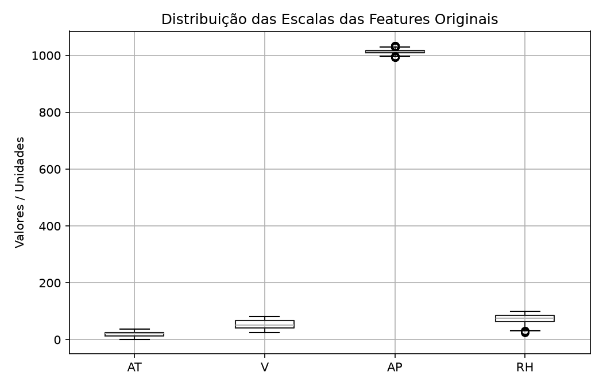
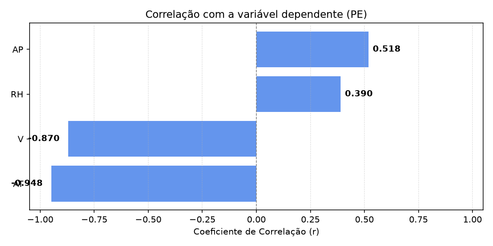
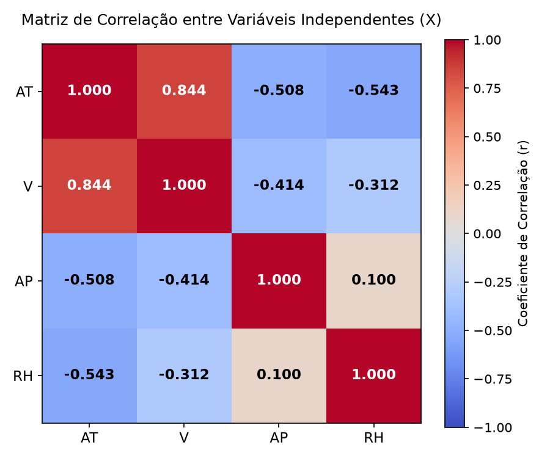

# Relatório do Problema 1: Regressão Linear para Previsão de Produção de Energia em Usina de Ciclo Combinado

## 0. Pré-Processamento dos Dados

Antes da construção do modelo preditivo, foram realizadas as seguintes etapas de preparação dos dados:

1. **Tratamento de Valores Ausentes:** A verificação realizada por meio de `df.isna().sum()` constatou zero valores ausentes, dispensando a aplicação de métodos de imputação ou descarte de instâncias.

2. **Análise de Escalas:** Por meio da análise via *boxplot*, observou-se que as variáveis operam em ordens de grandeza distintas (por exemplo, `AP` em torno de 1000 mbar, enquanto `AT` varia entre 1.8°C e 37.1°C).

3. **Divisão do conjunto de dados em treino e teste e Normalização (Prevenção de *Data Leakage*):**

- O conjunto de dados foi splitado em 80% para treino (7.654 amostras) e 20% para teste (1.914 amostras) com `random_state=42` (para fins de reprodutibilidade).

- Para evitar vazamento de dados (*data leakage*), o escalonamento padronizado (`StandardScaler`) foi ajustado exclusivamente sobre os dados de treino (`fit_transform`) e posteriormente aplicado aos dados de teste (`transform`).

---

## 1. Tarefa 1: Correlação entre Variáveis Independentes e a Variável Alvo ($PE$)

Para avaliar o grau de linearidade e a influência de cada variável independente em relação à produção de energia ($PE$), foi calculada a correlação de Pearson:

| Variável | Descrição | Correlação com $PE$ ($r$) | Tipo de Relação |
| :--- | :--- | :---: | :--- |
| **AT** | Temperatura Ambiente | **-0,948** | Linear muito forte (inversa) |
| **V** | Vácuo de Exaustão | **-0,870** | Linear forte (inversa) |
| **AP** | Pressão Ambiente | **+0,518** | Linear moderada (direta) |
| **RH** | Umidade Relativa | **+0,390** | Linear moderada/fraca (direta) |

A partir disso, é possível concluir na tarefa 1 que:

- A variável `AT` é a que possui a **maior influência** sobre a produção de energia, apresentando um coeficiente de correlação de -0,948.

- O sinal negativo demonstra que `AT` e `PE` são inversamente proporcionais, logo, quanto menor for a temperatura ambiente, maior será a produção de energia gerada pela usina.

- A variável `V` também apresenta forte correlação negativa (-0,870), enquanto `AP` e `RH` possuem relações positivas de menor magnitude.

---

## 2. Tarefa 2: Correlação entre as Variáveis Independentes (Multicolinearidade)

A correlação mútua entre as features de entrada foi avaliada para identificar a presença de multicolinearidade:

| | AT | V | AP | RH |
| :--- | :---: | :---: | :---: | :---: |
| **AT** | 1,000 | 0,844 | -0,508 | -0,543 |
| **V** | 0,844 | 1,000 | -0,414 | -0,312 |
| **AP** | -0,508 | -0,414 | 1,000 | 0,100 |
| **RH** | -0,543 | -0,312 | 0,100 | 1,000 |

1. **Existe multicolinearidade entre `V` e `AT`:** As features `V` e `AT` apresentam um coeficiente de correlação linear muito alto ($r = 0,844$). Isso indica fortemente a presença de multicolinearidade, ou seja, ambas as variáveis compartilham uma parcela expressiva de uma mesma informação.

2. **Independência relativa entre `AP` e `RH`:** As variáveis `AP` e `RH` registraram correlação muito baixa ($r = 0,100$), evidenciando que trazem informações distintas e complementares para a modelagem.

---

## 3. Tarefa 3: Construção do Modelo de Regressão Linear Múltipla

O modelo de Regressão Linear Múltipla foi implementado utilizando a biblioteca `scikit-learn`:

- O Algoritmo foi o `LinearRegression()`

- Sobre os dados de Treinamento: 80% das amostras com as features padronizadas anteriormente (`X_train_scaled`, `y_train`).

- Sobre os dados de Teste: 20% das amostras separadas previamente (`X_test_scaled`, `y_test`).

---

## 4. Tarefa 4: Avaliação de Desempenho e Adequação do Modelo

O desempenho preditivo do modelo foi medido sobre o conjunto de teste (dados não vistos durante o treinamento) por meio de três métricas centrais:

| Métrica | Valor Obtido | Significado Prático |
| :--- | :---: | :--- |
| **$R^2$ (Coeficiente de Determinação)** | **$0,9301$** | Explica $93,01\%$ da variabilidade de $PE$. |
| **$RMSE$ (Raiz do Erro Quadrático Médio)** | **$4,5026\text{ MW}$** | Desvio médio quadrático penalizando erros maiores. |
| **$MAE$ (Erro Médio Absoluto)** | **$3,5959\text{ MW}$** | Magnitude média do erro absoluto das previsões. |

A partir das métricas é possível dizer que sim, o modelo é altamente adequado para a previsão da produção de energia. As justificativas para essa conclusão se dão por meio dos resultados das métricas:

1. **Alto Poder Explicativo ($R^2 \approx 93\%$):**

- O coeficiente $R^2$ indica a proporção de variabilidade da variável dependente que é explicada pelas variáveis independentes.
- O modelo consegue explicar **93,01%** de toda a variação da geração de energia usando apenas a regressão linear com as 4 features. Em dados obtidos de sensores físicos que naturalmente carregam ruídos, esse percentual é considerado excelente.

2. **Erro Médio Absoluto Muito Baixo ($MAE \approx 3,60\text{ MW}$):**

- O $MAE$ demonstra que a previsão do modelo erra, em média, cerca de $3,59\text{ MW}$ para mais ou para menos.

- Sabendo que a produção média da usina é de aproximadamente **$454,10\text{ MW}$** (com faixa operacional entre $420$ e $496\text{ MW}$ e capacidade típica de blocos de ciclo combinado entre $400$ e $800\text{ MW}$), um erro de $3,60\text{ MW}$ representa menos de 1% (aproximadamente **$0,79\%$**) do total gerado.

3. **Consistência e Poucos Erros Grosseiros ($RMSE \approx 4,50\text{ MW}$):**

- O $RMSE$ eleva os desvios ao quadrado, sendo mais sensível à ocorrência de erros atípicos. Como o $RMSE$ resultou em um valor apenas ligeiramente superior ao $MAE$ (diferença inferior a $1\text{ MW}$), conclui-se que o modelo é consistente em suas inferências e praticamente livre de erros extremos.

4. **Capacidade de Generalização:**

- O comportamento das métricas entre treino ($R^2 \approx 0,928$, $RMSE \approx 4,57\text{ MW}$) e teste ($R^2 \approx 0,930$, $RMSE \approx 4,50\text{ MW}$) demonstra estabilidade total, sem ocorrência de *overfitting* ou perda de desempenho na generalização.