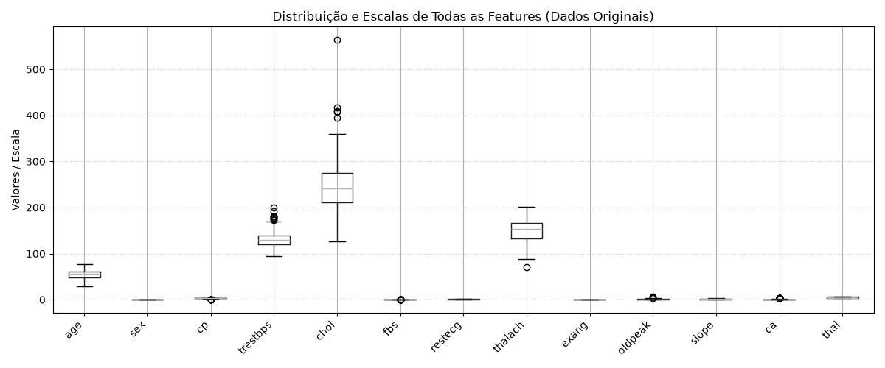
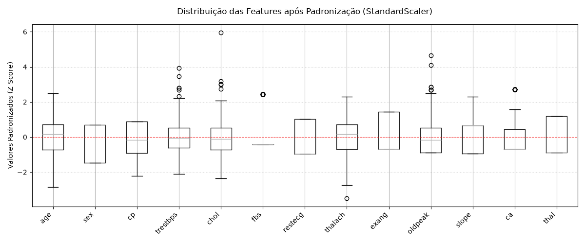
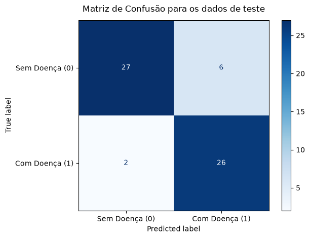
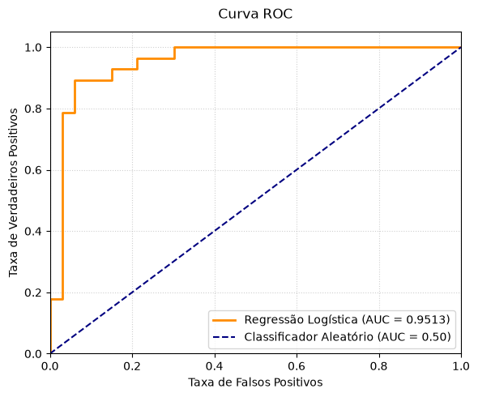

# Relatório do Problema 2: Regressão Logística para Previsão de Doenças Cardíacas

## 0. Pré-Processamento dos Dados

Antes da construção e do treinamento do modelo de classificação, foram realizadas etapas estruturadas de preparação dos dados clínicos provenientes do repositório UCI :

1. **Tratamento de Valores Ausentes (Imputação por Moda):**

A verificação realizada por meio de `df.isna().sum()` constatou a existência de dados faltantes nas features `ca` (4 valores nulos) e `thal` (2 valores nulos). Para tratar essas ausências sem descarte de instâncias, foi realizada a imputação dos valores mais frequentes (moda) por meio do `SimpleImputer(strategy='most_frequent')`.

O primeiro motivo para ter escolhido imputação por moda se dá primeiramente pelo fato de ser possível conseguir preservar as amostras e evitar que elas sejam eliminadas do dataset.

O segundo motivo está fato de eu ter escolhido especificamente a imputação por moda: as variáveis são discretas (retornam valores exatos de 1,2,3...). Dessa forma, não seria interessante realizar imputação por média pois geraria valores quebrados. Já a mediana, por mais que ela seja robusta aos outliers, eu queria preencher com os valores mais comuns das features. 

2. **Binarização da Variável Alvo (`num`):**

No conjunto de dados original, o atributo dependente (target) `num` varia de 0 a 4 (onde 0 indica ausência e os valores 1, 2, 3 e 4 indicam diferentes níveis de gravidade da doença cardíaca).

Para adequação ao problema de classificação binária, a variável foi mapeada segundo o critério:

- Valor do campo = 0: ausência de doença, assumindo classe `0` (*False*).
- Valor do campo > 0 (1, 2, 3 ou 4): presença de doença cardíaca, assumindo classe `1` (*True*).

A contagem de amostras resultou em:

- **Classe 0 (Sem Doença):** 164 amostras ($54,13\%$)
- **Classe 1 (Com Doença):** 139 amostras ($45,87\%$)

3. **Divisão do Conjunto de Dados em Treino e A Necessidade de Estratificar (`stratify`):**

Em seguida, os dados foram divididos na proporção de 80% para treino (242 amostras) e 20% para teste (61 amostras), com semente fixa (`random_state=42`) para fins de reprodutibilidade.

Foi Observado de forma prévia que as classes estavam levemente desbalanceadas ($54,13\%$ vs $45,87\%$). Por essa razão, foi utilizado o parâmetro `stratify=y_binario` durante a divisão (`train_test_split`).

O objetivo do uso do `stratify` durante o split de dados foi de garantir que os subconjuntos de treino e teste mantivessem de forma rigorosa a mesma proporção de pacientes com e sem doença. Isso evita que, pela aleatoriedade na escolha das amostras, ocorra uma divisão desbalanceada que concentre mais pacientes doentes no treino e menos no teste (ou vice-versa), o que prejudicaria o aprendizado e a avaliação mais fiel do modelo.

Vale mencionar que a **divisão foi realizada antes da etapa de normalização** para evitar vazamento de dados (*data leakage*).

4. **Análise de Escalas e Normalização (Padronização via `StandardScaler`):**

A análise da distribuição via *boxplot* indicou grande disparidade de magnitude entre as features. Variáveis como `chol` (colesterol sérico), `trestbps` (pressão arterial) e `thalach` (frequência cardíaca) operam em faixas numéricas dezenas ou centenas de vezes superiores à maioria das outras variáveis, que são binárias ou ordinais (operando entre 0 e 3).

Se não houvesse tratamento das escalas das features por meio da normalização, a feature `chol` esmagaria as variáveis binárias e categóricas, dominando indevidamente o cálculo dos gradientes da regressão logística.

Para equalizar as grandezas, aplicou-se o `StandardScaler`. O scaler foi ajustado exclusivamente sobre os dados de treino (`fit_transform`) e posteriormente aplicado sobre os dados de teste (`transform`), assegurando a integridade e impedindo *data leakage*.

---

## 1. Tarefa 1: Treinamento do Modelo de Regressão Logística e Convergência

Com as etapas de pré-processamento concluídas, o modelo de regressão logística foi instanciado e treinado através do `scikit-learn`:

- **Algoritmo e Hiperparâmetros:**
  - `LogisticRegression(solver='liblinear', random_state=42, max_iter=1000)`
- **Dados Utilizados:**
  - Treinamento conduzido sobre os 80% das instâncias padronizadas (`X_train_scaled`, `y_train`).
- **Convergência do Modelo:**

O algoritmo completou seu processo de otimização em apenas **5 iterações** (`model.n_iter_[0] = 5`), valor este que foi consideravelmente inferior ao limite estipulado de 1000 iterações.

---

## 2. Tarefa 2: Avaliação do Modelo nos Dados de Teste

A avaliação do desempenho do classificador foi conduzida sobre os dados de teste:

### Métricas de Desempenho Calculadas

| Métrica | Valor Obtido | Significado Prático no Problema |
| :--- | :---: | :--- |
| **Acurácia (Accuracy)** | **$0,8689$ ($86,89\%$)** | Percentual global de diagnósticos corretos (53 acertos em 61 casos). |
| **Precisão (Precision)** | **$0,8125$ ($81,25\%$)** | Dos pacientes classificados com doença, $81,25\%$ de fato eram doentes. |
| **Recall (Sensibilidade)** | **$0,9286$ ($92,86\%$)** | Dos pacientes que realmente tinham a doença, o modelo detectou $92,86\%$. |
| **F1-Score** | **$0,8667$ ($86,67\%$)** | Média harmônica entre precisão e sensibilidade, comprovando consistência geral. |
| **AUC-ROC** | **$0,9513$ ($95,13\%$)** | Capacidade global de discriminar entre indivíduos sadios e cardiopatas. |

---

### Análise da Matriz de Confusão

A matriz de confusão quantifica o detalhamento dos acertos e dos erros de classificação e é por meio dela que é possível ter uma visão geral do problema:

| | Predito: Sem Doença (0) | Predito: Com Doença (1) | Total Real |
| :--- | :---: | :---: | :---: |
| **Real: Sem Doença (0)** | **27** (VN) | **6** (FP) | 33 |
| **Real: Com Doença (1)** | **2** (FN) | **26** (VP) | 28 |
| **Total Predito** | 29 | 32 | 61 |

Falando um pouco mais agora sobre os erros cometidos pelo modelo de regressão logística 

- **Distribuição dos erros:** O modelo cometeu 8 erros no total de 61 predições de teste.
  - **6 Falsos Positivos (FP):** O modelo classificou 6 pessoas saudáveis como portadoras de cardiopatia.
  - **2 Falsos Negativos (FN):** O modelo diagnosticou como saudável 2 pacientes que efetivamente possuiam doença cardíaca.

---

### Análise da Curva ROC e Valor de AUC

Ao visualizar a curva ROC, percebe-se que ela atinge uma área sob a curva de **$95,13\%$** ($AUC = 0,9513$). Esse resultado demonstra que o modelo de regressão logística foi capaz de atingir taxas elevadas de verdadeiros positivos (previu que tinha doença e realmente está doente) mantendo taxas reduzidas de falsos positivos (falsos alarmes: previu que tinha doença sendo que o paciente não tem). 

Na prática, o modelo consegue prever de forma correta e com muito mais frequência os pacientes que realmente possuem a doença cardíaca do que prever que um paciente possui a doença sem ele realmente tê-la. E isso é bom em termos de erro pois indica que por mais que tenham ocorrido 8 erros, os erros mais importantes que foram referentes aos falsos negativos foram apenas 2.

Vale salientar que a curva ROC pode ser excessivamente otimista sob cenários de severo desbalanceamento de classes, o que não é o caso deste conjunto de dados ($54\%$ vs $46\%$). Ainda assim, por rigor metodológico, avaliou-se a métrica em conjunto com a matriz de confusão, a precisão e o recall para que futuramente fosse possível dar o veredito se o modelo treinado é bom ou não para o projeto.

---

### Discussão Crítica e Adequação do Modelo

A partir dos resultados obtidos, é possível analisar criticamente a adequação do modelo à tarefa de diagnóstico:

1. **Acurácia e Consistência Global:**

O modelo acerta aproximadamente $87\%$ de todas as previsões, apresentando um F1-Score com percentual similar ($86,67\%$), o que atesta equilíbrio entre detectar casos positivos e evitar alarmes falsos. O desempenho global é consistente e não favorece indevidamente nenhuma classe.

Contudo, a acurácia quando tratada de forma isolada não é o suficiente para determinar se o modelo proposto é clinicamente adequado para o problema.

2. **A Centralidade do Recall no Contexto Médico:**

A principal métrica a ser analisada para validar se o modelo cumpre seu papel prático é o **Recall** pois no contexto de diagnóstico clínico de cardiopatias, é muito mais crítico identificar todos os pacientes doentes (minimizando os falsos negativos).

Avaliando a gravidade dos erros, é possível interpretar que:

- Os **6 Falsos Positivos** configuram um erro de menor importância: 

O paciente passará por exames complementares adicionais para confirmação, mas não corre risco clínico imediato decorrente da omissão de cuidado.

- Os **2 Falsos Negativos** representam o erro mais perigoso: 

O paciente com doença cardíaca real recebe diagnóstico incorreto de normalidade, é liberado sem tratamento e pode sofrer complicações graves ou fatais.

O modelo obteve um Recall expressivo de **$92,86\%$**, identificando com sucesso **26 dos 28 pacientes verdadeiramente doentes** presentes na base de teste.

---

Conclui-se que **o modelo de Regressão Logística apresentou um desempenho satisfatório e clinicamente viável para triagem**, mantendo alta capacidade discriminatória ($AUC \approx 95\%$) e sensibilidade elevada ($Recall \approx 93\%$).

Como perspectiva de melhoria futura, recomenda-se explorar o ajuste fino do limiar de probabilidade de decisão (*threshold moving*) ou algoritmos complementares com o objetivo de mitigar a zero a quantidade de falsos negativos, otimizando a métrica de Recall.
