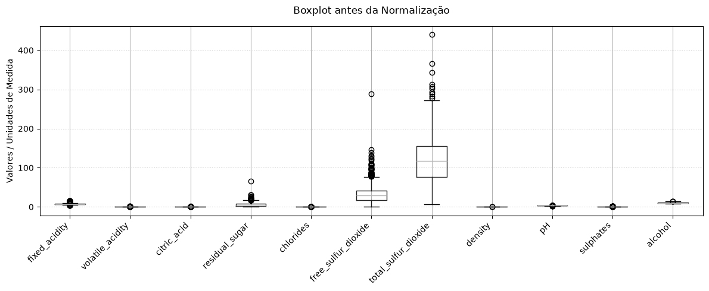
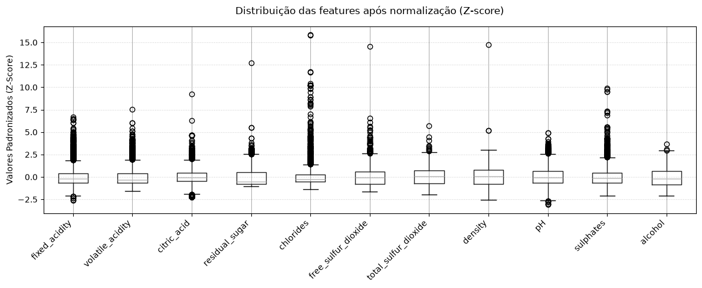
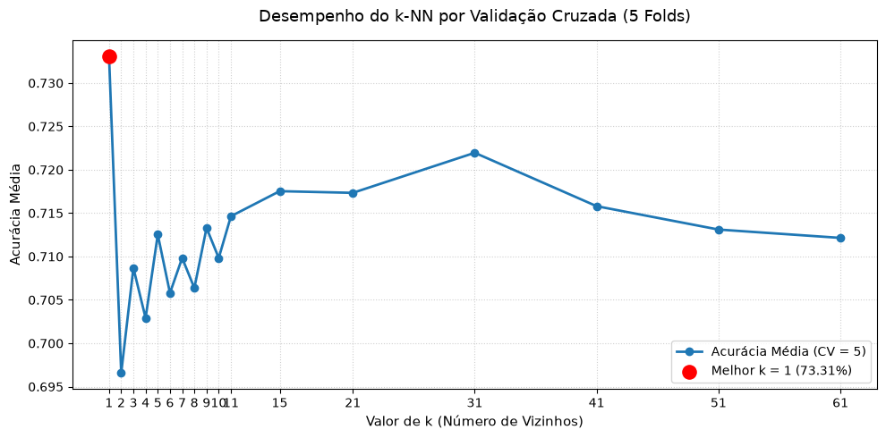
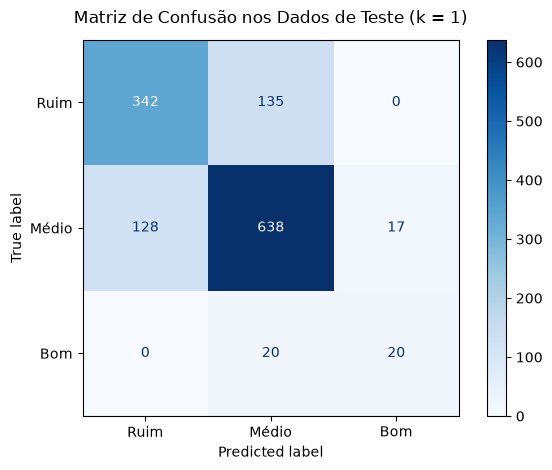

# Relatório do Problema 3: Classificação da Qualidade de Vinhos Utilizando $k$-NN

## 0. Pré-Processamento e Análise Exploratória dos Dados

Antes da construção e da avaliação do modelo preditivo, foram realizadas etapas estruturadas de preparação e inspeção dos dados clínicos/químicos provenientes do repositório UCI:

1. **Tratamento de Valores Ausentes:**

A verificação de integridade realizada por meio de `df.isna().sum()` constatou um total de zero valores ausentes tanto no conjunto de features ($X$) quanto na coluna target ($y$), dispensando a necessidade de aplicação de métodos de imputação ou descarte de instâncias.

---

## 1. Tarefa 1: Preparação dos Dados, Recodificação e Normalização

### 1.1 Recodificação da Variável Target (`quality`)

A variável dependente original `quality` foi recodificada em três classes ordinais de qualidade segundo os critérios estabelecidos pelo problema:

- **`ruim`:** notas $\le 5$ (vinhos de qualidade inferior)
- **`medio`:** notas 6 e 7 (vinhos de qualidade intermediária)
- **`bom`:** notas $\ge 8$ (vinhos de qualidade superior)

A distribuição das classes resultante no dataset revelou:

- **Classe `medio`:** 3.915 amostras ($60,26\%$)
- **Classe `ruim`:** 2.384 amostras ($36,69\%$)
- **Classe `bom`:** 198 amostras ($3,05\%$)

Observou-se que a variável target é fortemente desbalanceada: a classe `bom` representa apenas cerca de $3\%$ de todo o conjunto de dados. Essa constatação evidencia que o classificador tenderá naturalmente a privilegiar a classe majoritária (`medio`), reforçando a necessidade mandatória de uma divisão amostral estratificada na etapa seguinte.

---

### 1.2 Análise de Escalas das Features e Justificativa da Normalização para o $k$-NN

Por meio da visualização do *boxplot* das features originais, constatou-se que todas as 11 variáveis preditoras (features) são quantitativas contínuas, porém operam sob ordens de grandeza extremamente discrepantes.

Features como `total_sulfur_dioxide` (com valores atingindo até 440) e `free_sulfur_dioxide` (atingindo até 289) achatam visual e matematicamente variáveis que operam em frações decimais, como `density` (entre 0,98 e 1,03), `chlorides` (entre 0,009 e 0,61) e `volatile_acidity`.

#### Por que a normalização é uma etapa obrigatória para o $k$-NN?

1. **Dependência de Métrica de Distância:** O algoritmo $k$-NN é um classificador baseado em instâncias que decide o rótulo de uma nova amostra calculando a distância geométrica em relação aos vizinhos no espaço vetorial $n$-dimensional.

2. **Domínio Matemático de Grandezas Maiores e as Consequências sem Normalização:** 

Como as diferenças entre coordenadas são elevadas ao quadrado, pequenas variações em atributos de grande escala (como uma variação de 20 unidades em `total_sulfur_dioxide`, que gera impacto de $(20)^2 = 400$) dominam desproporcionalmente o somatório, enquanto variações sutis em `density` (como 0,02, gerando $(0,02)^2 = 0,0004$) tornam-se virtualmente desprezíveis para o cálculo.

Sem a padronização, o $k$-NN fica enviesado e é incapaz de captar padrões das variáveis de menor magnitude numérica, tornando-as irrelevantes independentemente de sua importância química real na qualidade do vinho.

Para resolver esse problema foi aplicado o escalonamento padronizado (`StandardScaler`) do scikit-learn para transformar os dados via $Z$-score, centralizando cada atributo na média 0 com desvio padrão unitário ($\mu = 0, \sigma = 1$). O resultado garantiu que todas as features passassem a contribuir com o mesmo peso no cálculo de vizinhança.

---

## 2. Tarefa 2: Divisão Treino e Teste com Estratificação (`stratify`)

O conjunto de dados previamente normalizado foi particionado na proporção clássica de 80% para treinamento e 20% para teste, fixando-se a semente aleatória `random_state=42` para fins de reprodutibilidade:

- **Conjunto de Treinamento:** 5.197 amostras ($80\%$)
- **Conjunto de Teste:** 1.300 amostras ($20\%$)

### A Necessidade da Estratificação (`stratify=y_cat`)

Como identificado previamente na Tarefa 1, a classe `bom` compõe apenas $3,05\%$ de todo o dataset (198 amostras). Em um particionamento puramente aleatório sem controle de distribuição. Dessa forma, corria-se o risco de concentrar vinhos raros em apenas um dos conjuntos ou deixar o conjunto de teste desprovido de instâncias suficientes da classe minoritária. 

O uso do parâmetro `stratify=y_cat` garantiu que tanto o treino quanto o teste mantivessem exatamente a proporção original das classes:

- **Treino (5.197 amostras):** $60,26\%$ médio (3.132), $36,69\%$ ruim (1.907) e $3,05\%$ bom (158).

- **Teste (1.300 amostras):** $60,26\%$ médio (783), $36,69\%$ ruim (477) e $3,05\%$ bom (40).

---

## 3. Tarefa 3: Treinamento e Escolha do Hiperparâmetro $k$

Para determinar o número ideal de vizinhos próximos ($k$), foi implementado um laço de validação cruzada com **5 folds** (`cv=5`) sobre o conjunto de treinamento (`X_train`, `y_train`), avaliando múltiplos valores de $k$:

$$k \in [1, 2, 3, 4, 5, 6, 7, 8, 9, 10, 11, 15, 21, 31, 41, 51, 61]$$

Em cada iteração, calculou-se a acurácia média e o desvio padrão entre os folds de validação:

| $k$ | Acurácia Média (CV = 5) | Desvio Padrão ($\pm \sigma$) |
| :---: | :---: | :---: |
| **1** | **$0,7331$ ($73,31\%$)** | $\pm 0,0088$ |
| **2** | $0,6966$ ($69,66\%$) | $\pm 0,0094$ |
| **3** | $0,7087$ ($70,87\%$) | $\pm 0,0117$ |
| **4** | $0,7029$ ($70,29\%$) | $\pm 0,0129$ |
| **5** | $0,7125$ ($71,25\%$) | $\pm 0,0124$ |
| **7** | $0,7098$ ($70,98\%$) | $\pm 0,0096$ |
| **11** | $0,7146$ ($71,46\%$) | $\pm 0,0038$ |
| **15** | $0,7175$ ($71,75\%$) | $\pm 0,0071$ |
| **21** | $0,7173$ ($71,73\%$) | $\pm 0,0103$ |
| **31** | $0,7220$ ($72,20\%$) | $\pm 0,0108$ |

O valor com melhor desempenho médio obtido na validação cruzada foi **$k = 1$**, registrando acurácia média de **$73,31\%$**.

---

### O que acontece com o modelo para valores muito baixos e muito altos de $k$?

A variação do hiperparâmetro $k$ reflete diretamente o dilema fundamental entre viés e variância:

1. **Para valores muito baixos de $k$ (ex: $k = 1$):**

- **Alta Variância(Risco de *Overfitting*):** 

A classe predita é determinada exclusivamente pela amostra mais próxima no espaço vetorial. Caso haja uma amostra ruidosa, rotulada incorretamente ou um *outlier* pontual na vizinhança, o modelo propagará o erro diretamente na predição.

A superfície de decisão torna-se excessivamente recortada e irregular. Embora $k=1$ atinja pontuação elevada quando pontos semelhantes estão agrupados, o modelo perde capacidade de generalização suave.

2. **Para valores muito altos de $k$ (ex: $k \gg 30$):**

O modelo abrange uma vizinhança demasiadamente ampla, diluindo as particularidades locais das distribuições químicas. Como a classe `medio` representa mais de 60% dos dados, um $k$ muito alto faz com que ela vença a imensa maioria das votações por contagem de votos.

O classificador perde então a sensibilidade para delimitar fronteiras entre classes minoritárias, tendendo a ignorar completamente a classe `bom` (apenas 3% dos dados).

---

## 4. Tarefa 4: Avaliação do Modelo nos Dados de Teste

Com o hiperparâmetro selecionado ($k = 1$), o modelo final foi ajustado sobre a totalidade do conjunto de treinamento e avaliado:

- **Acurácia Global no Teste:** **$76,92\%$**

### Métricas Detalhadas por Classe

| Classe | Precisão | Recall | F1-Score | Suporte (Instâncias Reais) |
| :--- | :---: | :---: | :---: | :---: |
| **Ruim** | $0,73$ ($72,8\%$) | $0,72$ ($71,7\%$) | $0,72$ | 477 |
| **Médio** | $0,80$ ($80,1\%$) | $0,81$ ($81,5\%$) | $0,81$ | 783 |
| **Bom** | $0,54$ ($54,1\%$) | $0,50$ ($50,0\%$) | $0,52$ | 40 |
| **Média Ponderada** | **$0,77$** | **$0,77$** | **$0,77$** | **1.300** |

---

### Análise da Matriz de Confusão

| | Predito: Ruim | Predito: Médio | Predito: Bom | Total Real |
| :--- | :---: | :---: | :---: | :---: |
| **Real: Ruim** | **342** (VN/VP) | 135 | 0 | 477 |
| **Real: Médio** | 128 | **638** (VP) | 17 | 783 |
| **Real: Bom** | 0 | 20 | **20** (VP) | 40 |
| **Total Predito** | 470 | 793 | 37 | 1.300 |

---

### Resposta à Pergunta: Entre quais classes o modelo erra com mais frequência?

A análise da matriz de confusão e dos erros do classificador revela duas perspectivas essenciais:

#### 1. Em termos de Volume Absoluto de Casos:

O maior volume de erros absolutos ocorre entre as classes adjacentes **`ruim` e `medio`**, totalizando 263 erros, onde:

- **135 vinhos ruins** foram classificados incorretamente como médios
- **128 vinhos médios** foram classificados incorretamente como ruins

Esse volume elevado de erros nessas duas classes é justificado por dois fatores:

Ambas as classes somadas possuem quase **$97\%$** de todas as instâncias do conjunto de dados ($1.260$ das $1.300$ amostras de teste).

Vale destacar que entre os extremos **`ruim` e `bom`**, o modelo registrou zero erros ($0$ vinhos ruins classificados como bons e $0$ vinhos bons classificados como ruins), demonstrando que o $k$-NN diferencia com total consistência vinhos de qualidades opostas.

#### 2. Em termos de Proporção e Taxa de Erro Relativo (Sensibilidade da Classe):

Ao avaliar a proporção de acertos em relação ao total de instâncias de cada classe, **a classe com o pior desempenho relativo de predição é a classe `bom`**:

- **Taxa de erro de 50,0% no Recall:** O modelo errou exatamente metade de todos os vinhos verdadeiramente bons da base de teste ($20$ acertos e $20$ classificações errôneas como `medio`).
- **Precisão de 54,05%:** Das 37 vezes em que o modelo previu a classe `bom`, em 17 delas o vinho era apenas `medio`.
- **Menor F1-Score (0,52):** Em contraste com os índices de $0,81$ (`medio`) e $0,72$ (`ruim`), a classe `bom` sofreu fortemente com a escassez amostral (apenas 40 instâncias no teste).

---

No final,  é possível realizar algumas conclusões sobre o modelo que corroboram para que o resultado da classe que o modelo mais erra ser a `bom`. De forma geral, o modelo $k$-NN com $k=1$ atingiu uma acurácia global de $76,92\%$, o que supera de forma consistente a linha de base majoritária ($60,26\%$) em um problema multiclasse com atributos contínuos.

**- O impacto da Escolha do $k=1$:** 

A escolha de $k=1$ possibilitou capturar $50\%$ das instâncias da classe minoritária `bom`. Em experimentos com valores maiores de $k$ (como $k=11$), a votação da vizinhança é dominada pela densidade de amostras de classe `medio`, derrubando o Recall da classe `bom` para zero. Em contrapartida, $k=1$ introduz maior sensibilidade a ruídos locais.

Isso demonstra que por mais que o $k$ tenha sido escolhido como o melhor da validação cruzada, nada disso foi suficiente para melhorar o modelo, tendo em vista que houve um forte desbalanceamento de classes que não foi tratado.