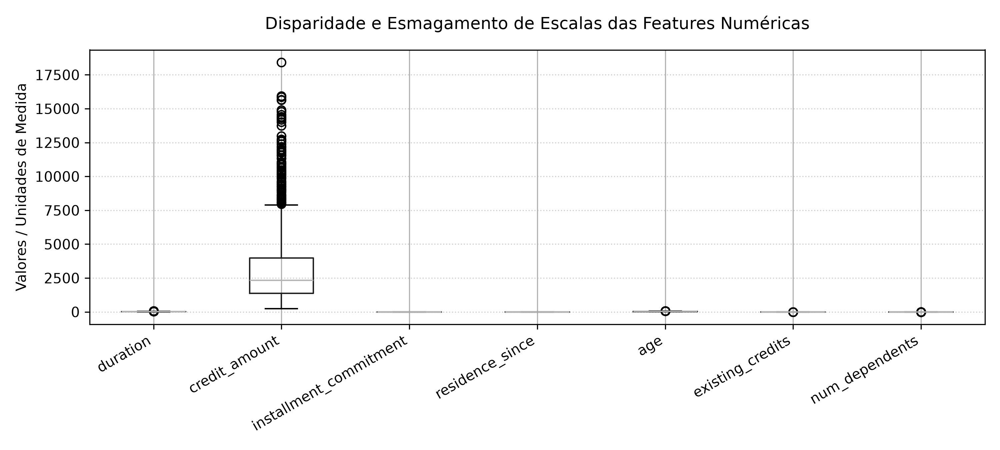
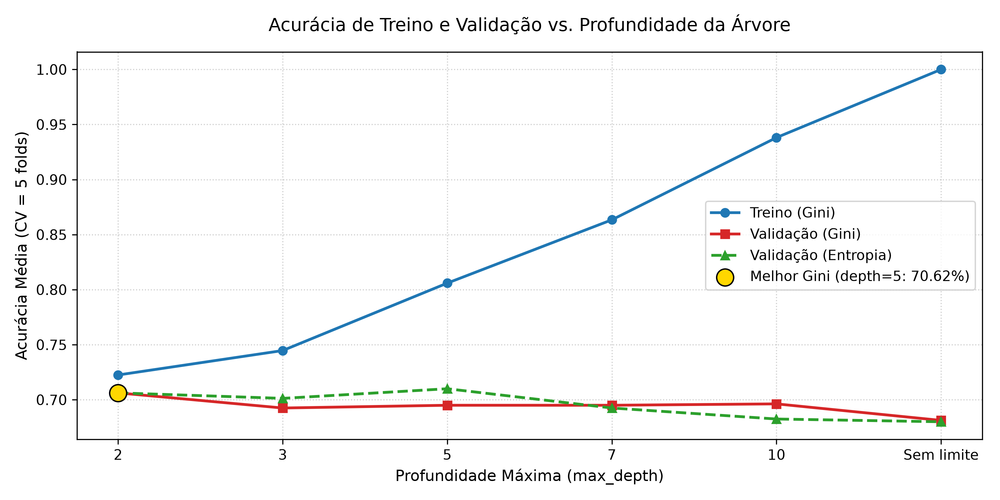
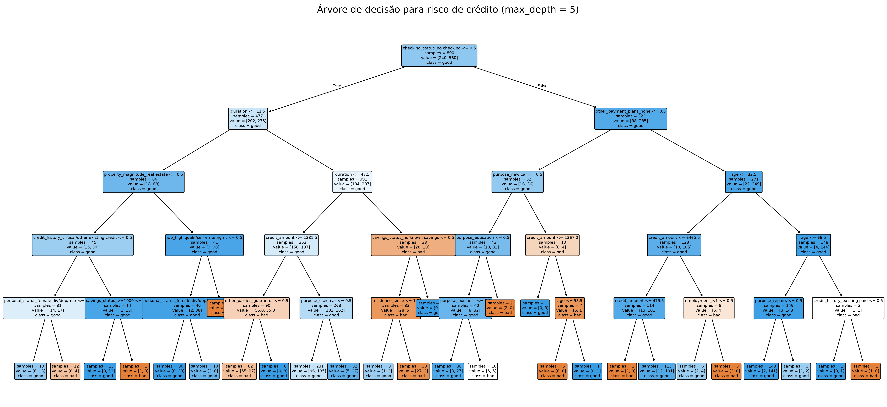
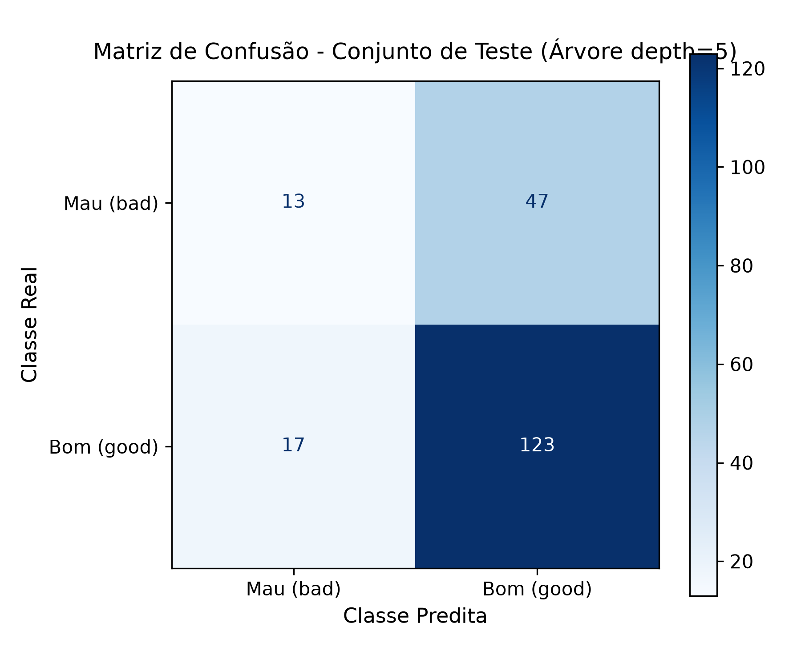
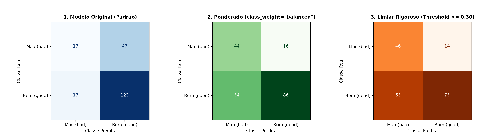
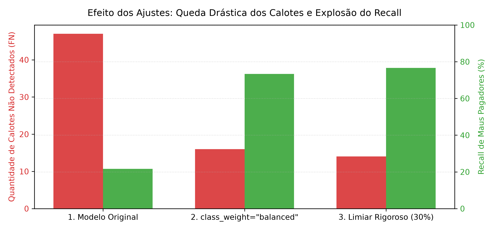

# Relatório do Problema 4: Classificação de Risco de Crédito Utilizando Árvores de Decisão

O objetivo deste projeto consiste em construir e avaliar um modelo preditivo para classificar solicitantes de empréstimo bancário em duas categorias de risco de crédito: **Bom Pagador (`good`)** e **Mau Pagador (`bad`)**, a partir de dados cadastrais e financeiros, utilizando o algoritmo de Árvore de Decisão.

---

## 1. Tarefa 1: Preparação dos Dados, Codificação e Análise de Desbalanceamento

### 1.1 Identificação e Tipologia dos Atributos

A análise dos metadados e dos tipos de dados revelou que as 20 variáveis preditoras originais se dividem em atributos quantitativos (numéricos) e qualitativos (categóricos):

* **Atributos Numéricos (7 features):** `duration`, `credit_amount`, `installment_commitment`, `residence_since`, `age`, `existing_credits`, `num_dependents`.
* **Atributos Categóricos (13 features):** `checking_status`, `credit_history`, `purpose`, `savings_status`, `employment`, `personal_status`, `other_parties`, `property_magnitude`, `other_payment_plans`, `housing`, `job`, `own_telephone`, `foreign_worker`.

Por meio da verificação de integridade realizada por meio de `.isna().sum()`, confirmou-se um total de **zero valores nulos** tanto nas variáveis preditoras ($X$) quanto no rótulo dependente ($y$), dispensando rotinas de imputação de dados faltantes.

---

### 1.2 Codificação de Variáveis Categóricas: One-Hot Encoding vs. Ordinal Encoding

Embora teoricamente árvores de decisão possam operar sobre dados categóricos diretos, a biblioteca `scikit-learn` impõe a restrição técnica de manipular matrizes estritamente numéricas (`float32`). Dessa forma, fez-se necessária a codificação dos atributos categóricos:

* **O Ordinal Encoding demonstrou-se inadequadro e optou-se por One-Hot Encoding:** 

A atribuição de números arbitrários (por exemplo, em `housing`: `own = 0`, `for free = 1`, `rent = 2`) seria indevida porque a feature é puramente nominal e não possui hierarquia natural. Ao mapear essas categorias em inteiros sequenciais, uma relação de ordem artificial seria imposta ($0 < 1 < 2$), levando a árvore a assumir equivocadamente que `rent` possui magnitude superior a `own`.

Optou-se então pela criação de colunas binárias indicadoras ($0$ ou $1$) para cada categoria distinta por meio da função `pd.get_dummies(X, columns=atributos_categoricos, dtype=int)`. Com essa transformação, o espaço dimensional foi expandido para mais colunas por conta do encoding, preservando a neutralidade geométrica e sem atribuir falsas relações de escala entre classes nominais.

---

### 1.3 Avaliação do Balanceamento das Classes e o Impacto na Acurácia

A apuração da variável target (`class`) totalizou a seguinte distribuição no conjunto de 1.000 clientes:

| Classe | Descrição | Quantidade de Amostras | Proporção Relativa (%) |
| :---: | :---: | :---: | :---: |
| **`good`** | Bom Pagador (Sem Risco / Concedido) | 700 | **$70,00\%$** |
| **`bad`** | Mau Pagador (Inadimplente / Risco) | 300 | **$30,00\%$** |


O desbalanceamento na proporção 70/30 faz com que o classificador fique naturalmente enviesado em prever a classe majoritária (`good`). Pelo fato de a proporção de instâncias `bad` ser menor, os padrões característicos associados aos clientes maus pagadores acabam recebendo menor ênfase nas divisões da árvore.

Como resultado, **a acurácia tradicional revela-se uma métrica enganosa** tendo em vista que um modelo ingênuo que simplesmente rotulasse todas as amostras como `good` atingiria $70\%$ de acurácia global, mesmo sendo completamente inútil na detecção de maus pagadores. Em termos práticos de concessão de crédito, o objetivo primordial do banco é justamente identificar e barrar o inadimplente (`bad`) para evitar prejuízo direto de capital.

---

## 2. Tarefa 2: Justificativa da Não Necessidade de Normalização para Árvores de Decisão

### 2.1 Análise Visual de Disparidade de Escalas

A inspeção estatística e visual das features numéricas antes do treinamento revelou ordens de grandeza completamente desiguais, como pode ser visto logo abaixo:



| Atributo | Mínimo | Média | Máximo | Unidade / Ordem de Grandeza |
| :--- | :---: | :---: | :---: | :---: |
| `credit_amount` | 250,0 | 3.271,26 | 18.424,0 | Milhares de unidades monetárias (DM) |
| `duration` | 4,0 | 20,90 | 72,0 | Dezenas de meses |
| `age` | 19,0 | 35,55 | 75,0 | Dezenas de anos |
| `existing_credits`| 1,0 | 1,41 | 4,0 | Unidades individuais |
| `num_dependents` | 1,0 | 1,15 | 2,0 | Unidades individuais |

A feature `credit_amount` opera na faixa de milhares, esmagando visualmente variáveis discretas e de magnitude unitária como `num_dependents` e `existing_credits`.

### 2.2 Mas por que a Árvore de Decisão Dispensa a Normalização?

Ao contrário de modelos como $k$-NN, Regressão Logística ou Redes Neurais, árvores de decisão são naturalmente imunes à disparidade de escalas devido a dois fundamentos teóricos:

1. **Os Nós são Avaliados de forma Univariada e Isolada:** Em cada nó de decisão, a árvore avalia apenas uma única variável por vez ($X_j \le s$). Como o algoritmo não realiza somas ponderadas, produtos escalares nem cálculos de distância euclidiana que misturem duas ou mais variáveis na mesma equação, a grande magnitude de `credit_amount` jamais interfere ou distorce o peso de variáveis de escala reduzida como `age`.

---

## 3. Tarefa 3: Divisão Treino e Teste com Estratificação (`stratify`)

O particionamento dos dados seguiu a proporção de 80% para treinamento e 20% para teste, com reprodutibilidade assegurada por `random_state=42`:

* **Conjunto de Treinamento ($80\%$):** 800 amostras
* **Conjunto de Teste ($20\%$):** 200 amostras

### O Papel da Estratificação (`stratify=y`)

Devido ao desbalanceamento original (70% bom / 30% mau), uma divisão estritamente aleatória poderia gerar subconjuntos com proporções desiguais. A aplicação da divisão estratificada garantiu a preservação rigorosa da distribuição original:

* **Proporção no Treino (800 amostras):** $70,00\%$ `good` (560 instâncias) e $30,00\%$ `bad` (240 instâncias).
* **Proporção no Teste (200 amostras):** $70,00\%$ `good` (140 instâncias) e $30,00\%$ `bad` (60 instâncias).

> Vale salientar que a estratificação evita viés amostral de avaliação ao assegurar que o teste represente fielmente a população do treino, contudo, ela ainda **não resolva** o problema do desbalanceamento dos rótulos intrínseco na indução da árvore.

---

## 4. Tarefa 4: Treinamento, Controle de Complexidade e Critérios de Divisão

Para investigar o equilíbrio entre viés e variância (*trade-off*), modelos de árvore foram treinados com diferentes profundidades máximas (`max_depth` $\in [2, 3, 5, 7, 10, \text{None}]$), sob validação cruzada estratificada com 5 folds sobre os 800 registros de treino.

O experimento foi conduzido para os critérios de impureza de **Gini** e **Entropia** (*Information Gain*):

| Profundidade (`max_depth`) | Treino Médio (Gini) | Validação Média (Gini) | Treino Médio (Entropia) | Validação Média (Entropia) | Diferença Absoluta (Gini vs Entropia) |
| :---: | :---: | :---: | :---: | :---: | :---: |
| **2** | $0,7128$ | $0,7062$ | $0,7128$ | $0,7062$ | $0,0000$ |
| **3** | $0,7409$ | $0,6925$ | $0,7322$ | $0,7012$ | $0,0087$ |
| **5** | **$0,8059$** | **$0,6950$** | **$0,7934$** | **$0,7100$** | **$0,0150$** |
| **7** | $0,8634$ | $0,6950$ | $0,8428$ | $0,6925$ | $0,0025$ |
| **10** | $0,9381$ | $0,6962$ | $0,9163$ | $0,6825$ | $0,0137$ |
| **Sem limite (`None`)** | $1,0000$ | $0,6812$ | $1,0000$ | $0,6800$ | $0,0012$ |



### 4.1 Análise de Underfitting e Overfitting

* **Para Árvores com Profundidades Muito Baixas (`max_depth = 2` ou `3`):** Caracterizam o **Underfitting** (alto viés). A árvore realiza pouquíssimas bifurcações, gerando um modelo excessivamente rígido e simplista, incapaz de capturar relações preditivas reais entre os atributos. As acurácias de treino e validação mantêm-se limitadas em torno de $70\%$.

* **Para Árvores com Profundidades Excessivas (`max_depth = 10` ou Sem Limite):** Caracterizam o **Overfitting** (alta variância). A árvore cresce descontroladamente memorizando ruídos e especificidades do conjunto de treino até atingir acurácia perfeita de $100\%$ no treino. Contudo, essa complexidade degrada o poder de generalização, fazendo a acurácia de validação despencar para $68,12\%$.

* **Ponto Ótimo de Equilíbrio:** A melhor capacidade de generalização e equilíbrio entre viés e variância foi verificada na região intermediária com **`max_depth = 5`** (acurácia de validação média de $69,50\%$ em Gini e $71,00\%$ em Entropia).

### 4.2 Comparativo entre os Critérios de Impureza: Gini vs. Entropia
A discrepância observada entre os dois critérios foi residual (diferença absoluta máxima inferior a $1,5\%$ em todas as profundidades e nula para `depth=2`). Isso comprova que, apesar das diferenças funcionais nos cálculos de impureza, Gini e Entropia tomam decisões de particionamento equivalentes na grande maioria dos nós. Optou-se pelo critério de **Gini** com **`max_depth = 5`** por apresentar menor custo computacional.

---

## 5. Tarefa 5: Interpretação do Modelo e Regras de Decisão

Com o hiperparâmetro fixado em `max_depth = 5` e critério `gini`, o modelo final foi ajustado sobre a totalidade do conjunto de treino (800 amostras).

### 5.1 Importância dos Atributos (*Feature Importances*)

A importância de cada atributo corresponde à redução total acumulada da impureza de Gini proporcionada por aquela variável em todas as divisões em que foi utilizada:



| Posição | Atributo / Feature | Importância Relativa | Descrição e Interpretação de Risco |
| :---: | :--- | :---: | :--- |
| **1º** | **`checking_status_no checking`** | **$31,09\%$** | Indica se o solicitante **não possui conta corrente** cadastrada ou mantém conta com histórico desconhecido/irregular. Foi a variável individual mais determinante da árvore. |
| **2º** | **`duration`** | **$13,46\%$** | Duração do empréstimo em meses. Prazos mais longos ampliam o horizonte temporal de incerteza e inadimplência. |
| **3º** | **`credit_amount`** | **$12,81\%$** | Montante total financiado. Valores elevados em relação ao perfil do solicitante aumentam o comprometimento de renda. |
| 4º | `other_parties_guarantor` | $5,66\%$ | Presença de garantidor ou fiador vinculado ao contrato. |
| 5º | `savings_status_no known savings` | $5,40\%$ | Ausência de poupança ou reservas financeiras conhecidas. |
| 6º | `age` | $3,91\%$ | Idade do solicitante do empréstimo. |

Juntas, as três primeiras variáveis respondem por **mais de $57\%$ de todo o poder decisório da árvore**.

---

### 5.2 Regra de Decisão da Folha com Maior Risco de Inadimplência

A inspeção da estrutura da árvore gerada pelo `export_text` identificou que o nó-folha com maior volume absoluto de clientes inadimplentes contém **82 amostras no total, das quais 55 pertencem à classe `bad` e 27 à classe `good`**.

O conjunto de regras determinísticas da raiz até esse nó traduz-se em linguagem natural da seguinte forma:

```
SE o cliente possui conta corrente cadastrada no banco (checking_status_no checking <= 0.5)
E o prazo do financiamento for superior a 12 meses (duration > 11.5)
E o prazo do financiamento for inferior ou igual a 47 meses (duration <= 47.5)
E o valor de crédito solicitado for relativamente baixo, até 1.381 DM (credit_amount <= 1381.5)
E o solicitante não possui garantidor ou fiador vinculado (other_parties_guarantor <= 0.5)
ENTÃO o solicitante é classificado como MAU PAGADOR (classe: 'bad').
```

---

## 6. Tarefa 6: Avaliação no Teste, Diagnóstico de Erros e Estratégias de Mitigação

O modelo final foi avaliado sobre o conjunto de teste independente (200 amostras: 140 `good` e 60 `bad`).

### 6.1 Matriz de Confusão e Métricas por Classe



* **Acurácia Geral no Teste:** **$68,00\%$** ($136 / 200$)

| Classe Real | Precisão | Recall (Sensibilidade) | F1-Score | Suporte Real |
| :--- | :---: | :---: | :---: | :---: |
| **`bad` (Mau Pagador)** | $43,33\%$ ($13/30$) | **$21,67\%$ ($13/60$)** | **$0,2889$** | 60 |
| **`good` (Bom Pagador)** | $72,35\%$ ($123/170$) | $87,86\%$ ($123/140$) | $0,7935$ | 140 |

---

### 6.2 Análise do Tipo de Erro Mais Frequente e sua Gravidade Financeira

O modelo cometeu um total de 64 erros no conjunto de teste, distribuídos de forma drasticamente assimétrica:

* **Falso Negativo (Classificar `bad` como `good`):** **47 ocorrências** (**$73,4\%$ de todos os erros**).
* **Falso Positivo (Classificar `good` como `bad`):** **17 ocorrências** ($26,6\%$ dos erros).

O modelo apresentou um **Recall de apenas $21,67\%$** para a classe `bad`. Em outras palavras, **a cada 100 inadimplentes que solicitaram crédito, o modelo deixou passar 78 deles sem detecção**.

#### Por que o Falso Negativo é o erro mais grave nesta aplicação?

Nesse cenário, podem haver dois problemas financeiros para o banco, expressos tanto pelos falsos positivos quanto para os falsos negativos:

1. **Falso Positivo (Bom cliente rotulado como mau):** O banco recusa a proposta de um cliente adimplente. Gera apenas custo de oportunidade (perda da margem de lucro e dos juros daquela operação), mantendo o patrimônio do banco preservado.

2. **Falso Negativo (Mau cliente rotulado como bom):** O banco concede crédito a um solicitante inadimplente que entra em calote (*default*). Ocorre a **perda integral do capital principal emprestado** (frequentemente de milhares de marcos/reais). O prejuízo causado por um único calote exige dezenas de contratos bem-sucedidos para ser amortizado.

---

### 6.3 Ajustes no Treinamento e Comprovação Prática

Para corrigir a vulnerabilidade do modelo original, foram implementadas e testadas duas melhorias técnicas:

1. **Ponderação de Classes (`class_weight='balanced'`):** Penaliza os erros na classe minoritária proporcionalmente ao inverso da frequência das classes durante a minimização da impureza de Gini.

2. **Ajuste de Limiar (*Threshold Moving* com corte em 30%):** Utiliza as probabilidades contínuas `predict_proba()` e classifica o solicitante como `bad` se a probabilidade estimada de risco for superior ou igual a $0,30$.



#### Tabela Comparativa Consolidada das Estratégias:

| Estratégia Adotada | Acurácia Geral | Recall (`bad`) | Precisão (`bad`) | F1-Score (`bad`) | Calotes Aprovados (FN) | Bons Rejeitados (FP) |
| :--- | :---: | :---: | :---: | :---: | :---: | :---: |
| **1. Modelo Original (Baseline)** | **$68,00\%$** | $21,67\%$ | $43,33\%$ | $0,2889$ | **47 calotes** | 17 |
| **2. Ponderado (`class_weight='balanced'`)** | $65,00\%$ | **$73,33\%$** | **$44,90\%$** | **$0,5570$** | **16 calotes** | 54 |
| **3. Limiar Ajustado ($P \ge 0,30$)** | $60,50\%$ | **$76,67\%$** | $41,44\%$ | $0,5380$ | **14 calotes** | 65 |



### 6.4 Conclusão Geral

É possível verificar que a aplicação de `class_weight='balanced'` provocou um salto no Recall da classe `bad` de **$21,67\%$ para $73,33\%$**, reduzindo os calotes liberados de **47 para apenas 16**. O modelo passou a barrar com sucesso **44 dos 60 clientes inadimplentes**.

O aumento dos Falsos Positivos (de 17 para 54) representa uma postura de crédito prudencial e conservadora, cuja relação custo-benefício é amplamente favorável em cenários bancários do mundo real.