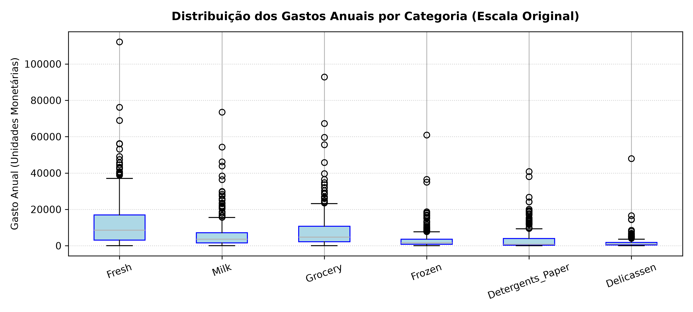
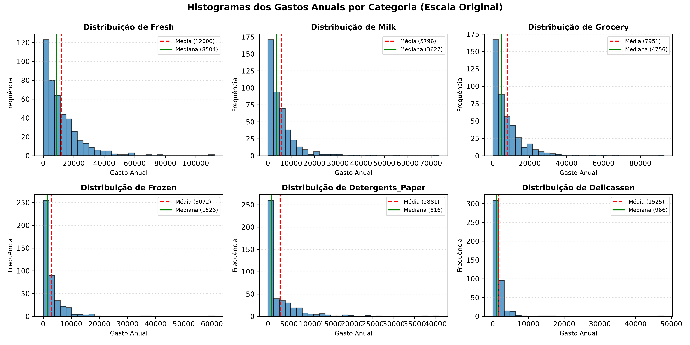
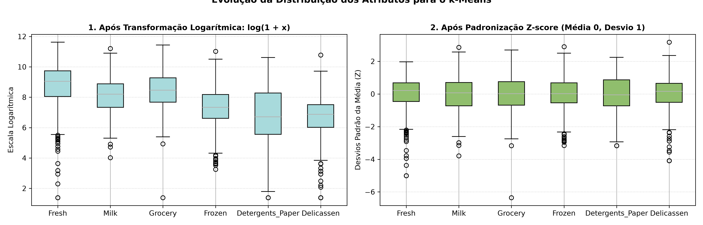
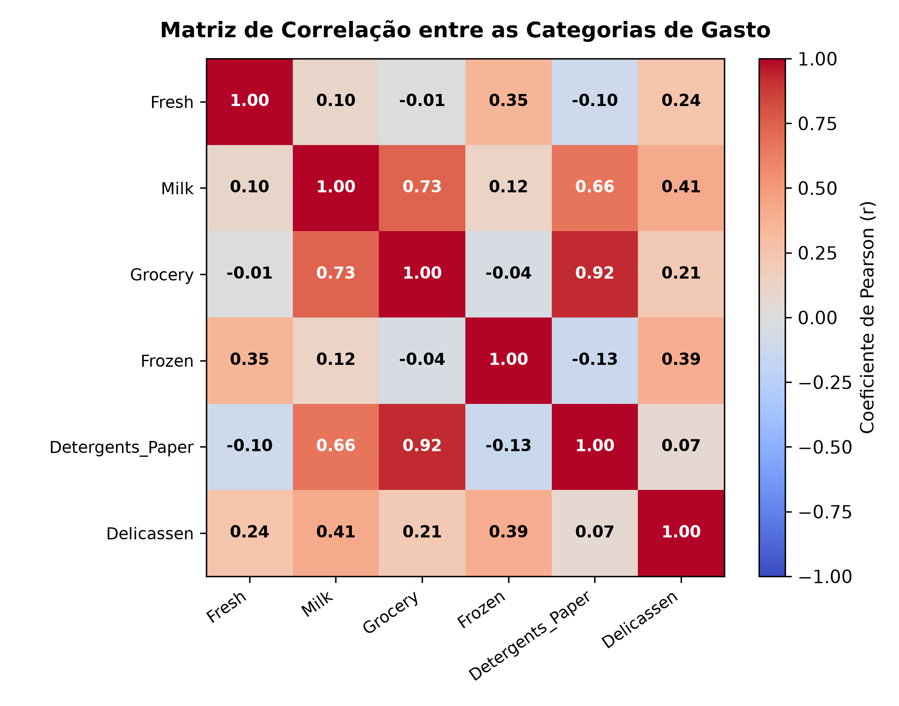
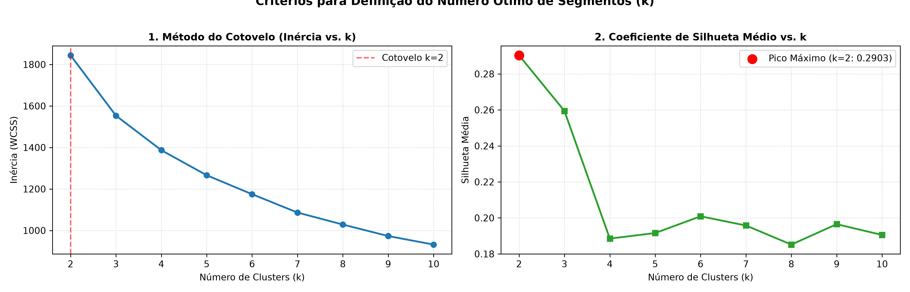
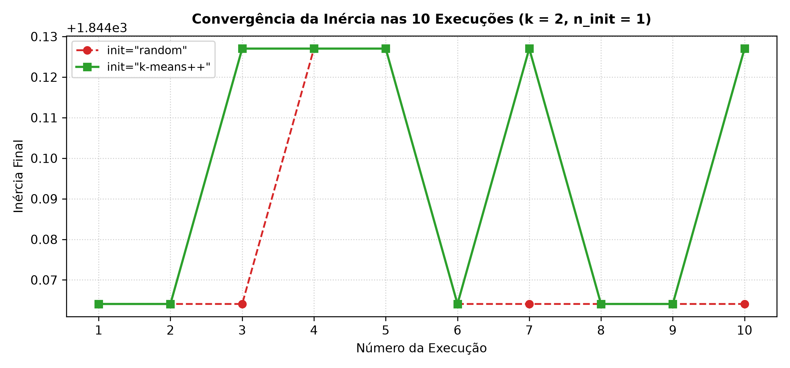
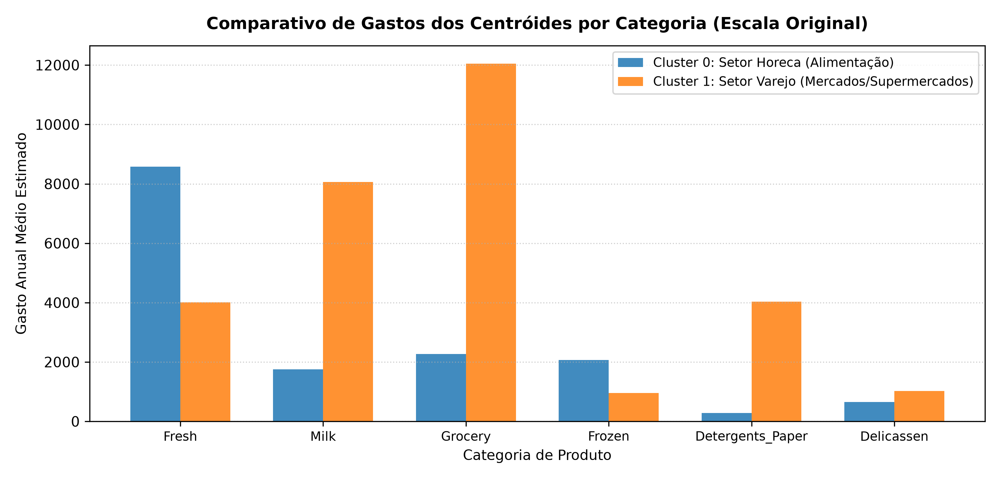
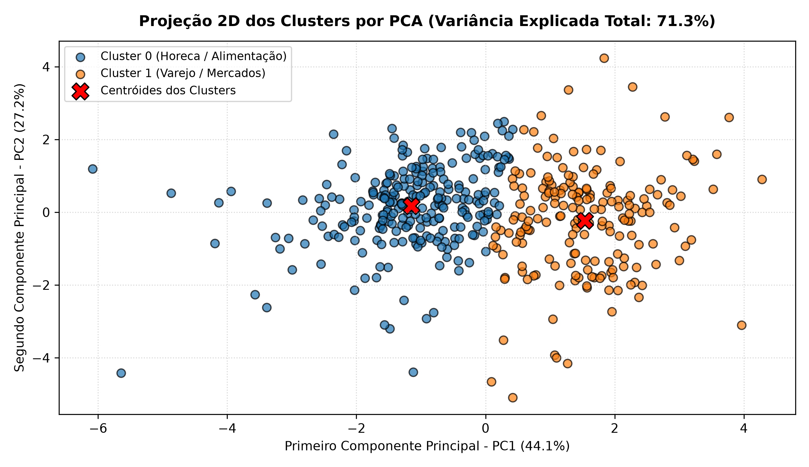

# Relatório do Problema 5: Segmentação de Clientes Utilizando $k$-Means

O objetivo deste projeto consiste em construir e avaliar um modelo de agrupamento (*clustering*) baseado no algoritmo $k$-Means para identificar perfis de consumo e padrões naturais de compra de clientes de um distribuidor atacadista.

---

## 1. Tarefa 1: Preparação dos Dados, Análise de Assimetria e Transformações

### 1.1 Separação dos Atributos e Estatísticas Descritivas

As variáveis `Channel` (canal de venda) e `Region` (região geográfica) foram inicialmente separadas dos atributos de gastos, reservando-as estritamente para a validação externa na Tarefa 5.

Para as seis categorias de gastos na escala monetária original, foram calculadas as métricas de tendência central, dispersão e assimetria:

| Categoria de Gasto | Média | Mediana | Desvio Padrão | Mínimo | Máximo | Assimetria (*Skewness*) |
| :--- | :---: | :---: | :---: | :---: | :---: | :---: |
| **`Fresh`** (Frescos) | $12.000,30$ | $8.504,00$ | $12.647,33$ | $3$ | $112.151$ | $+2,56$ |
| **`Milk`** (Laticínios) | $5.796,27$ | $3.627,00$ | $7.380,38$ | $55$ | $73.498$ | $+4,05$ |
| **`Grocery`** (Mercearia) | $7.951,28$ | $4.755,50$ | $9.503,16$ | $3$ | $92.780$ | $+3,59$ |
| **`Frozen`** (Congelados) | $3.071,93$ | $1.526,00$ | $4.854,67$ | $25$ | $60.869$ | $+5,91$ |
| **`Detergents_Paper`** (Detergentes/Papel) | $2.881,49$ | $816,50$ | $4.767,85$ | $3$ | $40.827$ | $+3,63$ |
| **`Delicassen`** (Delicatessen) | $1.524,87$ | $965,50$ | $2.820,11$ | $3$ | $47.943$ | $+11,15$ |

Vale mencionar que em todas as categorias de gasto a **média é expressivamente maior que a mediana** ($\text{mediana} < \text{média}$), e os coeficientes de assimetria são positivos (à direita) e muito elevados (atingindo $+11,15$ em `Delicassen`). Isso comprova matematicamente que as distribuições são fortemente assimétricas à direita.

---

### 1.2 Visualização da Assimetria: Boxplots e Histogramas

A inspeção gráfica por meio de *boxplots* e *histogramas* evidenciou a presença massiva de clientes com gastos atípicos (*outliers*) e uma longa cauda estendida para valores extremos:

A maioria dos 440 clientes concentra-se em faixas de consumo modestas, enquanto um número reduzido de grandes compradores atinge dezenas e centenas de milhares de unidades monetárias (por exemplo, mais de $112.000$ em `Fresh` e mais de $92.000$ em `Grocery`).

---

### 1.3 Transformação Logarítmica e Padronização ($Z$-Score)

Para viabilizar a convergência adequada do algoritmo do $k$-Means, o pré-processamento foi executado em duas etapas sequenciais:

#### Por que a transformação logarítmica $x' = \log(1 + x)$ é recomendável diante da assimetria e outliers ?

Como a função logarítmica é estritamente côncava com taxa de crescimento desacelerada, ela **comprime ordens de grandeza elevadas e expande variações relativas menores**. A distância linear entre $10.000$ e $100.000$ é de $90.000$, mas em escala logarítmica a diferença é de apenas $\approx 2,30$. Essa compressão "puxa" os clientes extremos para perto da média, amenizando o efeito de alavancagem dos *outliers* e simetrizando as distribuições (tornando-as próximas das distribuições gaussianas).

A fórmula $\log(1 + x)$ garante estabilidade numérica para valores nulos, pois $\log(1 + 0) = \log(1) = 0$, evitando a indeterminação de $\log(0) \to -\infty$.

#### Por que a padronização ($Z$-score) é determinante para o $k$-Means ?

O $k$-Means opera calculando a **distância euclidiana** entre as amostras e os centróides no espaço vetorial 6-dimensional:

$$d(x, c) = \sqrt{\sum_{j=1}^{6} (x_j - c_j)^2}$$

Como as diferenças são elevadas ao quadrado, caso os atributos não estivessem padronizados, a categoria com maior amplitude (`Fresh`) dominaria o cálculo com somatórios na casa de milhões, tornando categorias de menor magnitude (como `Delicassen`) irrelevantes.

A padronização via `StandardScaler` transforma cada variável para média zero ($\mu = 0$) e desvio padrão unitário ($\sigma = 1$), garantindo que todas as seis categorias de gastos contribuam com peso equivalente no cálculo de vizinhança.

---

### 1.4 Matriz de Correlação e Análise do par `Grocery`–`Detergents_Paper`

A análise de correlação linear de Pearson entre as seis categorias de gastos revelou a seguinte matriz:

| Atributo | `Fresh` | `Milk` | `Grocery` | `Frozen` | `Detergents_Paper` | `Delicassen` |
| :--- | :---: | :---: | :---: | :---: | :---: | :---: |
| **`Fresh`** | $1,0000$ | $0,1005$ | $-0,0119$ | $0,3459$ | $-0,1020$ | $0,2447$ |
| **`Milk`** | $0,1005$ | $1,0000$ | $0,7283$ | $0,1240$ | $0,6618$ | $0,4064$ |
| **`Grocery`** | $-0,0119$ | $0,7283$ | $1,0000$ | $-0,0402$ | **$0,9246$** | $0,2055$ |
| **`Frozen`** | $0,3459$ | $0,1240$ | $-0,0402$ | $1,0000$ | $-0,1315$ | $0,3909$ |
| **`Detergents_Paper`**| $-0,1020$ | $0,6618$ | **$0,9246$** | $-0,1315$ | $1,0000$ | $0,0693$ |
| **`Delicassen`** | $0,2447$ | $0,4064$ | $0,2055$ | $0,3909$ | $0,0693$ | $1,0000$ |

#### Sobre o par `Grocery`–`Detergents_Paper`:

Constatou-se uma **fortíssima correlação positiva de $r = 0,9246$ ($92,46\%$)**, a maior de todo o dataset. Essa associação foi interpretada comercialmente da seguinte forma:

Os clientes do canal de **Varejo (*Retail*)**, como supermercados e mercearias, compram grandes lotes de alimentos secos não perecíveis (`Grocery`) e, simultaneamente, produtos de limpeza e higiene doméstica (`Detergents_Paper`) para abastecer suas gôndolas para revenda ao consumidor final.

Por outro lado, restaurantes e hotéis (**Horeca**) consomem proporcionalmente muito menos produtos de limpeza por quilo de alimento manipulado. Esse par de variáveis atua como a principal "impressão digital" para discriminar os canais operacionais.

---

## 2. Tarefa 2: Ausência de Divisão Treino/Teste no Aprendizado Não Supervisionado

### 2.1 Aprendizado Supervisionado vs. Não Supervisionado

Nos problemas anteriores (como classificação com Árvores de Decisão ou Regressão Linear), utilizou-se a partição de treino e teste. No aprendizado supervisionado, o objetivo é aprender uma função preditiva $f(X) \approx y$ a partir de rótulos conhecidos. A divisão treino/teste é indispensável para estimar o **erro de generalização** em instâncias inéditas e monitorar *overfitting*.

Já no **Aprendizado Não Supervisionado (como no $k$-Means)**, não existe variável dependente alvo ($y$) pois o intuito **não é prever um rótulo futuro, mas sim descobrir e descrever a estrutura e os agrupamentos naturais embutidos na distribuição dos dados**.

Nesse caso, separar uma fração da base para "teste" seria ineficaz pelos seguintes motivos:

1. Não há gabarito no conjunto de teste para mensurar métricas de acurácia, matriz de confusão ou erro quadrático.
2. Descartar clientes para um conjunto de teste reduziria artificialmente a densidade amostral no espaço vetorial, prejudicando o posicionamento ideal dos centróides pelo algoritmo.
3. No contexto corporativo, o atacadista necessita segmentar a carteira completa de clientes cadastrados (todos os 440) para direcionar políticas imediatas de logística, crédito e tabelas de preços.

### 2.2 A Dificuldade Central da Validação em Agrupamento

A dificuldade central do agrupamento reside no fato de **não haver uma verdade absoluta (*Ground Truth*)**. Uma partição pode ser matematicamente compacta sob uma métrica geométrica, mas ser desprovida de utilidade prática comercial, ou vice-versa.

Para validar uma partição sem dispor de gabarito, a metodologia estatística apoia-se em três níveis de validação:

- **Validação Interna:** Avalia a geometria dos próprios dados através da **Coesão** (distâncias mínimas até o centróide, medida pela Inércia) e da **Separação** (distância máxima entre agrupamentos distintos, medida pelo Coeficiente de Silhueta).

- **Validação Externa:** Compara os agrupamentos gerados com variáveis de contexto do mundo real que não participaram do treinamento (como `Channel` e `Region`), utilizando métricas estatísticas como o **Índice Rand Ajustado (ARI)**.

- **Validação Relativa + Interpretabilidade Comercial:** Avalia a estabilidade comparativa ao variar hiperparâmetros (como $k$) e julga se os segmentos resultantes são compreensíveis e acionáveis pela equipe de negócios do atacado.

---

## 3. Tarefa 3: Escolha do Número de Grupos ($k$)

O algoritmo $k$-Means foi executado com $k$ variando de 2 a 10 sobre o conjunto padronizado `X_scaled`, monitorando a **Inércia (WCSS)** e o **Coeficiente de Silhueta Médio**:

| Número de Clusters ($k$) | Inércia Intra-Cluster (WCSS) | Coeficiente de Silhueta Médio |
| :---: | :---: | :---: |
| **$k = 2$** | $1.844,0641$ | **$0,2903$ (Pico Máximo)** |
| **$k = 3$** | $1.553,4213$ | $0,2594$ |
| **$k = 4$** | $1.386,8627$ | $0,1885$ |
| **$k = 5$** | $1.266,1494$ | $0,1916$ |
| **$k = 6$** | $1.174,7586$ | $0,2009$ |
| **$k = 7$** | $1.086,3587$ | $0,1958$ |
| **$k = 8$** | $1.028,4862$ | $0,1852$ |
| **$k = 9$** | $973,1415$ | $0,1965$ |
| **$k = 10$** | $931,9985$ | $0,1905$ |

### 3.1 Justificativa da Escolha de $k = 2$

O valor ótimo adotado foi **$k = 2$**, e o motivo de escolha desse hiperparâmetro foi baseado nos seguintes  pontos:

* **Pico da Silhueta:** O valor máximo de silhueta de todo o intervalo foi alcançado em **$k = 2$ ($0,2903$)**, atestando a melhor coesão intra-cluster e isolamento mútuo.

* **Método do Cotovelo:** A curva de inércia apresenta sua inflexão mais expressiva na transição até $k = 2$ e $k = 3$, com retornos marginais decrescentes e suaves a partir de $k \ge 4$.

### 3.2 As Demais Respostas Conceituais:

* **Por que a inércia decresce monotonicamente com $k$ ?**  
  A inércia é definida pela soma das distâncias euclidianas quadráticas mínimas:

  $$\text{Inércia} = \sum_{i=1}^{n} \min_{c_k} \| x_i - c_k \|^2$$
  
  A cada novo centróide acrescentado ($k+1$), ele é posicionado mais próximo de um subconjunto de pontos. Assim, a distância de cada amostra ao centro mais próximo **ou se reduz, ou permanece idêntica**, sendo matematicamente impossível a inércia aumentar com o incremento de $k$.

* **Por que a inércia não pode ser usada isoladamente ?**  
  Se fosse o único critério, o algoritmo sempre escolheria o maior $k$ possível. A inércia não penaliza o excesso de complexidade e pode forçar o particionamento arbitrário de agrupamentos naturais.

* **O que ocorre no caso limite em que $k = n$ ($k = 440$) ?**  
  Cada amostra individual torna-se o seu próprio centróide ($c_i = x_i$). A distância de cada ponto a ele mesmo é zero ($\| x_i - c_i \|^2 = 0$), resultando em **$\text{Inércia} = 0$**. Contudo, o modelo torna-se totalmente inútil, pois não realiza nenhuma condensação da informação (tem-se 440 grupos de 1 cliente).

---

## 4. Tarefa 4: Inicialização e Convergência (`random` vs. `k-means++`)

O algoritmo de Lloyd converge descendo a superfície da inércia até um mínimo local. Para comparar a estabilidade da inicialização, o $k$-Means ($k=2$) foi executado dez vezes sob dez sementes aleatórias distintas com uma única inicialização (`n_init=1`):

| Execução | Semente (*Seed*) | Inércia Final com `init='random'` | Inércia Final com `init='k-means++'` | Diferença (`random` - `plus`) |
| :---: | :---: | :---: | :---: | :---: |
| 1 | 10 | $1.844,0641$ | $1.844,0641$ | $0,0000$ |
| 2 | 20 | $1.844,0641$ | $1.844,0641$ | $0,0000$ |
| 3 | 30 | $1.844,1270$ | $1.844,0641$ | $+0,0630$ |
| 4 | 42 | $1.844,1270$ | $1.844,1270$ | $0,0000$ |
| 5 | 55 | $1.844,1270$ | $1.844,1270$ | $0,0000$ |
| 6 | 67 | $1.844,0641$ | $1.844,0641$ | $0,0000$ |
| 7 | 84 | $1.844,1270$ | $1.844,0641$ | $+0,0630$ |
| 8 | 99 | $1.844,0641$ | $1.844,0641$ | $0,0000$ |
| 9 | 123 | $1.844,0641$ | $1.844,0641$ | $0,0000$ |
| 10 | 2024 | $1.844,1270$ | $1.844,0641$ | $+0,0630$ |

| Métrica Estatística | `init='random'` | `init='k-means++'` |
| :--- | :---: | :---: |
| **Mínimo (Melhor Inércia Encontrada)** | $1.844,0641$ | $1.844,0641$ |
| **Média** | $1.844,0767$ | $1.844,0955$ |
| **Máximo (Pior Inércia Encontrada)** | $1.844,1270$ | $1.844,1270$ |
| **Desvio Padrão ($\sigma$)** | $0,0252$ | $0,0315$ |
| **Amplitude ($Max - Min$)** | $0,0630$ | $0,0630$ |

### 4.1 Discussão do Gráfico de Convergência

Para $k = 2$, a superfície de erro deste dataset é fortemente polarizada, fazendo com que tanto o `random` quanto o `k-means++` convirjam consistentemente para o mesmo mínimo com diferença residual de apenas $0,06$ (menos de $0,004\%$, correspondendo à alteração de apenas um cliente na fronteira de decisão).

### 4.2 O Problema Mitigado pelo `k-means++`

* **Deficiência do `random` (Forgy):** O sorteio puramente uniforme pode alocar centróides iniciais muito próximos entre si no mesmo aglomerado denso, fatiando um agrupamento natural ao meio e aprisionando o algoritmo em mínimos locais de inércia inflacionada (especialmente para $k \ge 3$).

* **Mecanismo do `k-means++`:** O primeiro centróide é sorteado aleatoriamente, mas os subsequentes são sorteados com probabilidade proporcional ao quadrado da distância mínima até o centro mais próximo:
  $$P(x) = \frac{D(x)^2}{\sum_{j=1}^{n} D(x_j)^2}$$
  
  Isso força os centróides a iniciarem **espalhados no espaço vetorial**, garantindo uma cobertura homogênea e reduzindo a dispersão das soluções finais.

---

## 5. Tarefa 5: Interpretação dos Centróides, Validação Externa e Projeção PCA

### 5.1 Centróides na Escala Original e Nomeação Comercial dos Grupos

Os centróides foram reconvertidos à escala monetária original desfazendo primeiramente o $Z$-score (`scaler.inverse_transform`) e, em seguida, a função logarítmica com a exponencial inversa ($x = \exp(y) - 1$ via `np.expm1`):

| Cluster | Quantidade de Clientes | `Fresh` | `Milk` | `Grocery` | `Frozen` | `Detergents_Paper` | `Delicassen` | Nome Comercial Sugerido |
| :---: | :---: | :---: | :---: | :---: | :---: | :---: | :---: | :--- |
| **Cluster 0** | **252** ($57,3\%$) | **$8.580,59$** | $1.753,72$ | $2.274,38$ | **$2.063,77$** | **$287,41$** | $649,35$ | **Setor Horeca (Hotéis, Restaurantes e Cafés)** |
| **Cluster 1** | **188** ($42,7\%$) | $4.013,88$ | **$8.061,61$** | **$12.051,12$** | $953,52$ | **$4.035,56$** | **$1.022,09$** | **Setor de Varejo (Supermercados e Mercados)** |

* **Cluster 0 — Setor Horeca:** Destaca-se pelos altos gastos em perecíveis frescos (`Fresh`: $8.580$) e congelados (`Frozen`: $2.063$, mais que o dobro do outro grupo), com consumo mínimo em papel e produtos de limpeza (`Detergents_Paper`: apenas $287$).

* **Cluster 1 — Setor Varejo:** Apresenta gastos maciços em mercearia seca (`Grocery`: $12.051$, mais de 5 vezes maior que o Cluster 0) e produtos de limpeza/higiene (`Detergents_Paper`: $4.035$, **14 vezes maior** que o Cluster 0).

---

### 5.2 Validação Externa com `Channel` e `Region`

Cruzando os agrupamentos gerados com as variáveis de contexto externas, obtiveram-se as seguintes tabelas de contingência:

#### Tabela de Contingência: Cluster vs. Canal de Venda (`Channel`)

| Agrupamento | Horeca (Hotéis, Restaurantes e Cafés) | Retail (Varejo) | Total de Clientes |
| :---: | :---: | :---: | :---: |
| **Cluster 0** | **244** ($96,8\%$) | 8 ($3,2\%$) | **252** |
| **Cluster 1** | 54 ($28,7\%$) | **134** ($71,3\%$) | **188** |
| **Total Geral** | **298** | **142** | **440** |

* **Adjusted Rand Index (ARI) para `Channel`:** $0,5135$ ($51,35\%$)

O algoritmo, sem jamais ter tido acesso ao rótulo `Channel`, foi capaz de reconstruí-lo: o Cluster 0 capturou **$96,8\%$ de estabelecimentos Horeca**, enquanto o Cluster 1 concentrou **$94,4\%$ de todo o varejo** do dataset ($134$ de $142$ clientes).

#### Tabela de Contingência: Cluster vs. Região Geográfica (`Region`)

| Agrupamento | Lisboa (1) | Porto (2) | Outras Regiões (3) | Total |
| :---: | :---: | :---: | :---: | :---: |
| **Cluster 0** | 48 ($62,3\%$) | 28 ($59,6\%$) | 176 ($55,7\%$) | **252** |
| **Cluster 1** | 29 ($37,7\%$) | 19 ($40,4\%$) | 140 ($44,3\%$) | **188** |
| **Total** | **77** | **47** | **316** | **440** |

* **Adjusted Rand Index (ARI) para `Region`:** $-0,0077$ (aproximadamente zero).

A distribuição de clientes nos clusters em Lisboa, Porto e demais regiões replica estritamente a proporção geral ($57\%$ no Cluster 0 e $43\%$ no Cluster 1). A região geográfica não influencia a formação dos grupos, provando que o padrão de compras é governado pelo **modelo de negócio do cliente** e não pela sua localização física.

#### Categorias que mais separam os canais:

O conjunto que mais discrimina os canais operacionais é **`Grocery` + `Detergents_Paper` (Varejo) versus `Fresh` + `Frozen` (Horeca)**.

---

### 5.3 Projeção Bidimensional por PCA e Limitações do $k$-Means

Os dados padronizados foram projetados em duas dimensões principais via PCA, retendo **$71,27\%$ de toda a variância original** ($\text{PC1} = 44,08\%$, $\text{PC2} = 27,19\%$):

#### As duas limitações do $k$-Means evidenciadas no gráfico:

1. **Tendência a Formar Grupos Esféricos com Fronteiras Lineares:**  
   O $k$-Means assume clusters hiper-esféricos e de dispersão similar. Na projeção do PCA, a nuvem de clientes é contínua e alongada; o algoritmo impõe um "corte reto" arbitrário perpendicular aos centróides, dividindo o espaço sem acompanhar a curvatura ou a densidade natural dos dados.

2. **Sensibilidade a Outliers:**  
   Mesmo após o logaritmo e a padronização, clientes atípicos persistem isolados nas extremidades (pontos com $\text{PC1} > 4$ ou $\text{PC2} > 4$). Devido à penalidade quadrática da inércia ($d^2$), esses pontos exercem efeito de alavancagem, puxando a posição dos centróides para longe do núcleo de maior densidade de clientes.